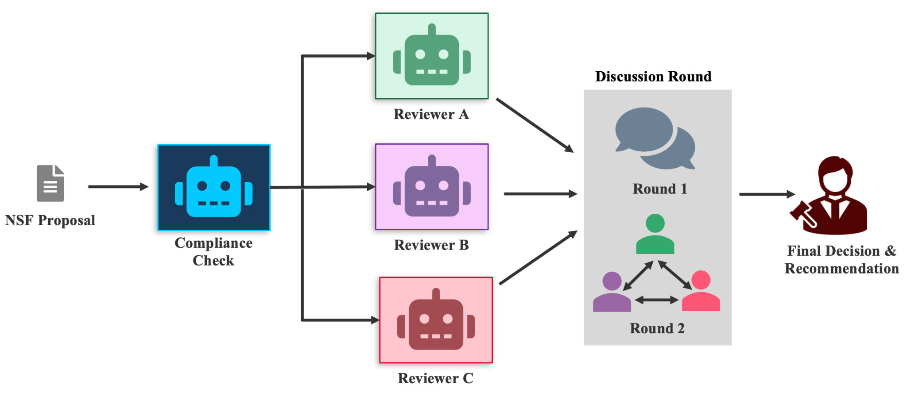

# NSF Agent Reviewer

Multi-agent research prototype for NSF-style proposal review. One compliance agent, three independent reviewers, structured discussion and final synthesis.

## Quick start

```bash
python3 nsf_reviewer_server.py
```

Open http://127.0.0.1:8000. Configure a supported provider (OpenAI, Anthropic, Gemini or Ollama). The Python backend uses the standard library. PDF extraction uses PDF.js via CDN; alternatively paste text.

## NSF Agent Reviewer Framework



A blocking compliance result skips substantive review. Otherwise, the server launches three independent full reviews, then runs opening positions, peer debate and final voting. Structured reports and consensus are returned to the browser through the job-status interface.

## Documentation

- [Design document](docs/NSF_DESIGN_DOCUMENT.txt)
- [Agent prompts](docs/AGENT_PROMPTS_REFERENCE.md)
- [Output variability](docs/OUTPUT_VARIABILITY_NOTES.txt)

Research prototype, not an official NSF service. AI output requires human verification. Cloud providers receive proposal content and credentials for processing; do not submit confidential proposals without authorization. Local Ollama is available. Do not commit API keys. The report credits Daniel Yu, Rohan Thakur and Quinn Madden.
